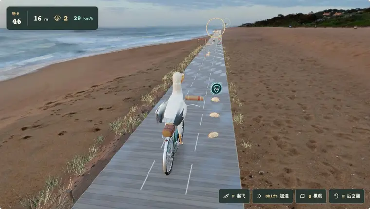

# Pelican Ride

Ride a bicycle along a coastal boardwalk at sunrise, then take off over the surf. The game opens with a 32-second cycling film. Select **开始骑行** to enter the endless runner.

**[Play Pelican Ride](https://nathan1658.github.io/pelican-ride/)**



## Play on a phone

Starting a ride on a phone expands the scene to the available screen. Steer with the on-screen arrows or a connected keyboard. Drag the scenery with one finger to look around, even while another finger is on the controls. Pinch with two fingers to zoom. Pause to reset the camera, change sound or return to the film.

| Action | Touch | Keyboard or mouse |
| --- | --- | --- |
| Change lanes | Tap ← or → | ← / → or A / D |
| Jump or duck | Tap ↑ or ↓ | ↑ / ↓ or W / S |
| Take off or land | Tap 起飞 / 降落 | F |
| Steer, climb and dive in flight | Hold a direction on the pad | Hold the arrow keys or WASD |
| Accelerate | Hold 加速 | Hold Shift |
| Barrel roll or backflip | Tap 横滚 or 后空翻 while airborne | Q / E |
| Look around and zoom | Drag with one finger to orbit, pinch to zoom | Drag and scroll |
| Pause or resume | Tap the round playback button | Space while the scene is focused |

The corner expand button works in the film and during a ride. It requests native fullscreen when available. For an edge-to-edge iPhone game without Safari’s tab and address bars, choose **Share → Add to Home Screen**, turn on **Open as Web App**, and launch from the new icon. [Apple’s iPhone guide](https://support.apple.com/guide/iphone/iphea86e5236/ios)

The game requires WebGL 2. Android browsers with installation support offer **Install app**. Let the first online visit finish loading and caching before playing offline. Sound is optional and starts from the speaker button.

## Scoring

Collect shells on the boardwalk or follow the airborne shell trails through the rings. Complete rolls and backflips before landing. Alternating tricks and rings within the combo window increases the multiplier. A shield absorbs one collision, the magnet attracts shells, and a tailwind gives a temporary speed boost. Best distance and score are saved on the device.

## Run or rebuild

The playable site is checked into `docs/`. To serve it locally, run this from the repository root, then open [localhost:8000](http://localhost:8000/).

```sh
python3 -m http.server 8000 --directory docs
```

To edit the game, change the modules or HTML template in `src/`. The build uses Node.js, npm, esbuild and Three.js.

```sh
npm ci
npm run build
```

The build embeds the models' procedural geometry, JavaScript, fonts, panorama and HDR lighting into `docs/index.html`. It also versions the service worker's offline cache. GitHub Pages publishes `docs/` from `main`; commit the rebuilt files alongside source changes.

## Test

```sh
npx playwright install chromium
npm test
```

The browser test starts a local server under the project-site path and exercises touch steering, simultaneous climb and boost, stunts, cancellation, responsive layout and offline reload. Set `GAME_URL` to the live project URL to run the same checks on a deployment.

## Credits

The pelican, bicycle, boardwalk, waves and crash sequence are built from procedural geometry, shaders and animation. Three.js powers the WebGL renderer. [Three.js license](licenses/three.txt)

The coastal panorama and HDR lighting use Greg Zaal's *Umhlanga Sunrise* from Poly Haven under CC0. [Environment asset](https://polyhaven.com/a/umhlanga_sunrise)

The title uses Instrument Serif under the SIL Open Font License. [Font license](licenses/instrument-serif.txt)
